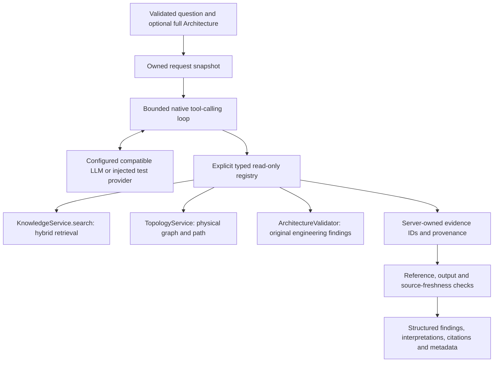

# Phase 3 agent architecture

The application uses one request-scoped LLM orchestration loop with four explicitly
registered read-only tools. It reuses the deterministic Phase 1 services and the Phase 2
hybrid retrieval pipeline. There are no independent agents, agent frameworks, additional
provider SDKs, write tools, persistent conversations or background jobs.

## Integration and authority

`agent/tools/adapters.py` is the only engineering integration layer. It calls Python
services directly. It does not duplicate graph algorithms, traffic assignment, budget
calculations, retrieval fusion, citation construction or conflict detection. The Phase 1
domain, validator and topology service retain their existing semantics. The existing
compatible-provider HTTP boundary gains a cancellable, response-bounded asynchronous
variant; the Phase 2 synchronous provider remains compatible.

`ModelFinal` contains only a summary, labeled interpretations/assumptions,
recommendations, unresolved questions and an insufficient-evidence flag. It has no
validation object, status, source metadata or requirement-ID fields. The server copies
each collected `ValidationFinding` into `AgentFinding.validation` with its exact rule ID,
requirement ID, severity, PASS/FAIL/NOT_EVALUATED status, components, explanation and
evidence. It attaches these findings even when generation fails. Generated findings
have `interpretation_status=unverified`; server-copied validation entries use
`not_applicable` for that interpretation label.

English verification-claim guards conservatively reject generated outcome language,
including PASS/FAIL/NOT_EVALUATED, satisfied, compliant, certified, verified and passed.
Even seeing a real PASS does not authorize the model to generalize it to another
requirement. Bounded identifier checks reuse Phase 2's identifier grammar. Reference
integrity and these guards do not prove natural-language entailment, completeness or
multilingual grounding. Human review of generated interpretations remains necessary.

## Tool contracts

Every definition includes a unique name, description, Pydantic input/result types,
positive execution timeout and read-only classification. Duplicate names and write
definitions are rejected. Only explicit registrations are exposed as native function
definitions. No reflection, dynamic imports, eval, shell or HTTP endpoint dispatch is used.
Pydantic rejects extra arguments and validates tool JSON in strict mode. Provider
schemas set `strict=false`: optional defaults are accepted across compatible servers,
while the application performs its own strict validation.

| Tool | Input | Typed result and scope |
| --- | --- | --- |
| `search_requirements` | `query` (1–5000 characters), `top_k` (integer 1–10, default 5), optional `filters` with document ID, version or requirement ID | Phase 2 `SearchResponse`: exact IDs, versions, chunk/source locations, text, ranks, methods and ranking metadata; always hybrid, never answer generation |
| `get_architecture_topology` | `max_nodes`, `max_links` (integers 1–100, default 50 each) | Physical topology, node names/kinds, endpoint/link attributes, isolated nodes, connected components, original counts and explicit truncation flag |
| `find_physical_path` | Exact `source_device_id`, `destination_device_id` | Physical path existence, ordered nodes and link IDs, ordered link attributes, original physical limitations and representative-route warning |
| `validate_architecture` | Optional nonempty `rule_ids`, restricted to the five existing rule IDs | Existing validator report, exact selected findings, original overall report status, scope note and number of omitted findings |

Available rules are `structure.consistency`, `connectivity.physical_path`,
`bandwidth.traffic_evaluability`, `bandwidth.nominal_link_budget` and
`requirement.evaluability`. A rule filter limits the returned findings, not the
calculation or original report status. A PASS for one rule is never overall compliance.
Successful validation executions also expose `tool_executions[].validation_scope` with
architecture ID, original full-report status/scope, selected rules and omitted-finding
count. Filtered omissions are repeated in response limitations. These fields come from
the actual validator result, even when omitted findings are outside the selected scope.

Unknown endpoints are errors. Disconnected known endpoints produce `exists=false`.
The path service chooses a minimum-hop physical path and one lexicographically selected
parallel link per hop. Alternative paths can exist; the result never assigns service
traffic. Physical adjacency does not prove VLAN forwarding, IP routing, SOME/IP, TSN,
protocol translation or application reachability.

Topology output that omits nodes or links is explicitly truncated; component lists
are withheld rather than representing incomplete components as complete. Such execution
returns PARTIAL. Oversized results are rejected intact, with no evidence committed from
that result. Validation findings are never clipped or converted to generated estimates.
The model may retry with a supported narrower rule/query scope. Very large architectures
can remain incomplete; there is no topology/validation pagination in this MVP.

## Request context and access

`AnalyzeRequest.architecture` uses the complete existing Phase 1 `Architecture` model.
It is optional for retrieval-only questions. The application copies and revalidates the
submitted model, then binds adapters to that snapshot. Model arguments contain no file
paths, URLs or selectable architecture IDs. There is no sample-ID resolver; send the full
sample JSON. The initial prompt contains only the question, architecture-availability
flag and description of the current-request handle. Device details are disclosed through
tools. Concurrent requests have separate snapshots, evidence stores and histories.

Server code may inject an `AgentContext.document_scope` using the existing Phase 2
`SearchFilter`. Model filters must agree with every enforced scope field; omitted fields
inherit the scope and conflicting values are denied before retrieval. HTTP clients cannot
set the server scope. The deployed MVP inherits Phase 2's local single-user index and has
no authentication or tenant ACLs. A scope mechanism is not a complete authorization system.
Only `KnowledgeService.search` is exposed: ingestion, reindex, replacement and deletion
are unavailable to the model. Phase 2 service/index provisioning retains its existing
lazy initialization behavior; analysis does not write architecture or source records.

## Orchestration and failure behavior

1. Build a request snapshot, policy, trace and registry.
2. Send the role/policy, final-output schema, question and native tool definitions.
3. Check the total serialized context size before each provider call.
4. Parse tool calls, reject malformed protocol/duplicate call IDs, enforce the total budget.
5. Validate each tool's JSON arguments and execute through the registry.
6. Validate and size-check results, stage evidence, size-check the complete wire envelope,
   and commit evidence only if the result will actually be disclosed.
7. Return one native tool message per admitted call, correlated with `tool_call_id`.
8. Continue or validate final JSON, allowing at most one repair within the same budgets.
9. Recheck retrieved source revisions, copy deterministic findings and build the response.

Multiple calls in one model response execute sequentially. Admitted attempts consume the
budget even when arguments are invalid or the tool is denied. No further call executes
after exhaustion. Unknown tools, malformed arguments, missing architectures/endpoints,
storage or embedding errors, timeouts and oversized results return safe error codes.
Unrelated successful evidence survives. Provider failures stop the loop. Cancellation
propagates to the asynchronous provider and caller. Unexpected provider/tool exceptions
are sanitized; raw error strings never appear in traces or responses.

`asyncio.wait_for` bounds caller waits. Existing synchronous engineering/storage work
runs in a thread. Python cannot forcibly terminate an already running thread; a timed-out
read may finish in the background. Its late result is never committed. The standard
executor bounds active threads, but production concurrency/rate limiting and process
isolation for pathological CPU/storage work belong to later hardening.

## Evidence and provenance

Evidence labels (`E1`, `E2`, …) are allocated only by the server. Retrieval records retain
document ID/version, chunk ID, requirement ID, source location, original chunk and ranking
data. Identical chunks deduplicate even if a repeated query changes rank. Distinct
validator executions retain execution ID, finding ID, rule ID and component IDs. Path and
topology records contain actual typed tool results. Native result envelopes map evidence
labels to result indexes; the model cannot create new evidence objects.

Every generated statement's reference list must resolve within this execution.
Interpretations require a reference; assumptions and recommendations may explicitly
lack one. Requirement IDs mentioned within a statement must belong to its referenced
evidence, subject to the documented bounded identifier grammar. Citation objects are
constructed with the existing Phase 2 citation function, never model metadata.

Source revisions are captured under the existing store lock during search and rechecked
before returning. Replaced/deleted or uncheckable sources cause requirement citations
and generated prose to be withheld, while independent validation evidence remains.
The response discloses the freshness issue. The check is not a cross-process transaction
or a guarantee against changes after response generation. Equal statement templates
with different quantities reuse Phase 2's bounded conflict detector: both sources stay
traceable and the response requests an engineer's applicability/precedence decision.

## API and status semantics

`POST /api/v1/agent/analyze` is a single request/response operation documented in OpenAPI.
It accepts `question`, optional full `architecture`, and optional `options` with lower
iteration/call limits and `include_trace`. Requests cannot increase server limits.
The existing streaming body middleware limits bytes before JSON parsing for knowledge
and agent routes, including chunked requests.

| Agent status | Meaning |
| --- | --- |
| `COMPLETED` | Valid final response and supporting tool evidence, without execution errors or collected unresolved evaluations; does not imply design PASS |
| `INSUFFICIENT_EVIDENCE` | Execution finished but evidence is absent, model flags insufficiency, sources conflict, or collected validation findings include NOT_EVALUATED |
| `PARTIAL` | Execution was limited, a tool failed, topology was truncated, sources expired/could not be checked, or generation failed after useful execution |
| `FAILED` | Unrecoverable provider, protocol or final-output error before useful tool execution/evidence |

HTTP 200 carries completed, insufficient or partial analysis, including real engineering
FAIL findings. Input errors/raised request limits return 422, excessive bodies 413 and
missing/invalid provider configuration 503. Provider/protocol/final-output failures
without usable execution return a structured FAILED response with 502, or 504 for the
outer provider deadline. Partial results retain HTTP 200 and explicit failed checks.

## Configuration and observability

The defaults and validated ranges are defined in `core/settings.py` and `.env.example`.
`AGENT_PROVIDER=none` disables production analysis until configured; `openai_compatible`
uses `AGENT_MODEL` with `LLM_MODEL` fallback and existing `LLM_BASE_URL`, `LLM_API_KEY` and
`PROVIDER_TIMEOUT_SECONDS`. URLs must be trusted HTTP(S) endpoints without embedded
credentials. No API keys are sent to the LLM as prompt content. HTTP redirects are disabled.
The compatible server must support `/chat/completions`, native function calls,
`response_format=json_object`, and `max_tokens`. Servers/models with other dialects
need an explicit adapter. See the [official function-calling protocol](https://developers.openai.com/api/docs/guides/function-calling).

| Policy setting | Default | Trade-off |
| --- | --- | --- |
| `AGENT_MAX_ITERATIONS` | 6 | More rounds permit discovery/refinement but increase latency and cost; output repair also consumes rounds |
| `AGENT_MAX_TOOL_CALLS` | 10 | Includes denied/invalid admitted calls; higher values permit more reads |
| `AGENT_TIMEOUT_SECONDS` | 60 | End-to-end caller deadline, including source recheck |
| `AGENT_TOOL_TIMEOUT_SECONDS` | 10 | Per-call wait, capped by remaining request time |
| `AGENT_MAX_TOOL_RESULT_BYTES` | 16384 | Complete JSON envelope limit; smaller values can reject otherwise valid large findings |
| `AGENT_MAX_ARGUMENT_BYTES` | 4096 | Bound individual argument JSON |
| `AGENT_MAX_CONTEXT_BYTES` | 131072 | Bound complete serialized messages and tool schemas; bytes are not tokenizer-specific tokens |
| `AGENT_MAX_PROVIDER_RESPONSE_BYTES` | 262144 | Bounded HTTP/model response parsing |
| `AGENT_MAX_OUTPUT_TOKENS` | 2000 | Provider output budget each round |
| `AGENT_ENABLE_TRACING` | true | Allows metadata-only logs and requested response traces |
| `MAX_REQUEST_BYTES` | 1100000 | Existing streamed request-body cap |

Traces include request/trace IDs, iterations, tool name/call ID, duration, execution
status, provider durations and token usage when available. Tool executions are always
in the response; `options.include_trace=true` includes detailed events when tracing is
enabled. The `ee_arch_copilot.agent.trace` Python logger emits structured `agent_trace`
metadata through logging `extra`; configure an application JSON formatter if desired.
There is no persistent trace store. Prompts, arguments, architecture payloads, document
contents, API keys and raw provider errors are excluded from logs. Exact prompt echoes
and configured credential strings in generated text are rejected as a bounded safeguard.

Token totals are null unless every LLM iteration reports usage. Cost is null unless
complete usage and both explicit USD-per-million input/output prices are configured.
Prices are administrator-provided estimates; there is no built-in price table or claim
of exact billing. Tracing can be disabled independently of usage aggregation.

## Security limits and Phase 4 extension points

The tool allowlist, typed arguments, request scope, enforced limits and server-owned
provenance are application controls; prompt-injection resistance does not rest on
instructions alone. A malicious document may still influence the model's interpretation
or choice among approved reads. General semantic faithfulness, arbitrary identifier
grammars, multilingual claim detection and general conflict reasoning remain unproven.
The MVP has no production authentication, tenant isolation, global rate limiting or
isolated worker termination. Keep proprietary sources within approved provider/data
handling boundaries. This assistant does not certify functional safety or compliance.

Phase 4 can consume `AgentResponse`, exact validator findings and evidence provenance
to render reviewed reports and measure interpretation quality. No report generator,
architecture mutation workflow, automatic approval, multi-agent system or new network
verification engine is implemented as part of Phase 3.
