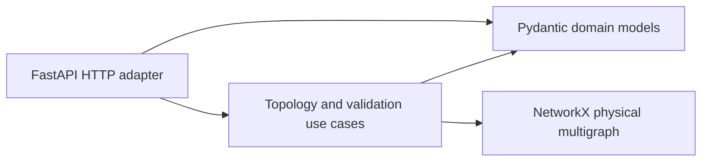

# Architecture and engineering semantics

## Dependency boundaries

`domain/models` defines serializable data and structural invariants. Models reject
invalid references before the analysis services run. They depend on Pydantic, not
FastAPI or NetworkX. No database, dependency injection framework, repository interface,
or speculative provider abstraction is necessary in Phase 1.

`services/topology.py` builds one undirected multigraph per request. Nodes are ECUs
and switches. Edges retain link IDs, endpoint interfaces, technology, nominal capacity,
and VLAN annotations. Multiple device-to-device links keep separate edge keys.
`find_physical_path` returns an unweighted minimum-hop physical path; one parallel
edge per hop is selected by lexicographic link ID. This selection never assigns traffic.
`direct_neighbors` returns unique neighboring device IDs. `disconnected_devices()`
returns isolated nodes; with a reference ID it returns all unreachable devices.
Exports include connected components so separate connected islands remain visible.

`services/validator.py` revalidates a copy of the root model, builds the topology,
and emits typed findings. Revalidation protects Python callers from mutations to
previously validated nested models. The topology service also copies and revalidates
its input. There is no shared analysis state between calls.

`api/routes` maps schema errors to 422, unknown path query devices to 404, and
successful evaluations to 200. A `FAIL` result is an engineering finding, not an HTTP
server error. `main.create_app` allows isolated application construction in tests.

## Structural invariants

- IDs have a bounded, nonempty identifier syntax. Names cannot be whitespace only.
- Device IDs are unique across ECUs and switches. Links, services, and requirements
  have unique IDs within their respective collections.
- Interface/port IDs are unique within a device. Ethernet switches contain Ethernet
  ports only. Ethernet interfaces cannot participate in multiple physical links.
- Endpoints exist and have matching technologies. Self-links are rejected.
- Speeds and link capacities are positive finite Mbps values when present. Service
  demand is finite and nonnegative. Link capacity cannot exceed a known endpoint speed.
- VLAN IDs are unique per interface, in 1–4094, and only supported on Ethernet.
- Service providers/consumers refer to ECUs, not switches. Consumers and routed
  consumers are unique. Protocol labels carry no implicit transport support.
- Traffic routes reference existing links, form a continuous simple path, and end
  at their consumer. They are physical declarations, not proof of forwarding.
- Requirement references resolve to existing devices, links, or services. Constraint
  kinds match requirement types. Free-text requirements are not silently interpreted.

An empty architecture is structurally valid. Isolated devices are also valid unless
a structured connectivity requirement demands a missing connection. Structural
validity and engineering adequacy are separate judgments.

## Three connectivity questions

| Question | Phase 1 behavior |
| --- | --- |
| Does a physical path exist? | Evaluated over undirected physical adjacency |
| Can VLAN traffic pass? | Not evaluated; memberships are retained as annotations |
| Can an application/service communicate? | Not evaluated; no protocol, deployment, discovery, or policy engine |

Physical paths may cross disjoint VLANs or Ethernet/CAN boundaries. Such paths
prove physical adjacency only. In particular, ECU nodes are not assumed to bridge
interfaces, and gateway protocol translation is not inferred. A representative
path is not a valid service route merely because the graph contains it.

## Deterministic rules and evidence

| Rule ID | Evidence and interpretation |
| --- | --- |
| `structure.consistency` | Validated counts, or structural error messages for mutated Python inputs |
| `connectivity.physical_path` | Explicit source/destination, path node IDs and link IDs, physical scope |
| `bandwidth.nominal_link_budget` | Link capacity, per-direction/shared routed demands, missing information, assumptions |
| `requirement.evaluability` | Free-text or unsupported isolation constraint and why it is unevaluated |

Findings have `rule_id`, nullable `requirement_id`, `severity`, `status`,
`affected_components`, `explanation`, and `evidence`. Report status gives failure
precedence over incompleteness, then success. It does not certify the architecture.

Bandwidth constraints list links to check. Links without an associated bandwidth
requirement are also checked, with a null requirement ID. Multiple requirements can
independently refer to one link. Each demand is counted once per declared consumer
route per link. Ethernet budgets are per direction; CAN uses a shared link budget.
Decimal summation avoids common floating-point boundary errors in quantities already
parsed as finite floats. Evidence encodes sums as decimal strings with explicit Mbps units.

Port speeds are not substituted for missing link capacity. If any communicating
service has unknown demand or any missing consumer route, the unknown traffic might
use any link. Every otherwise passing link check becomes `NOT_EVALUATED`. A known
overload still fails because additional traffic cannot remove the demonstrated excess.
These are nominal budget checks over the declared traffic inventory, not guaranteed
throughput, scheduling, or service-delivery checks. An isolation requirement always
remains `NOT_EVALUATED` in Phase 1, including when devices appear physically disconnected.

## Extension points

Add infrastructure adapters when Phase 2 introduces document sources and retrieval
storage. Keep document parsing, provenance, retrieval, and provider calls outside the
domain model modules. Define the smallest provider contracts needed by those real
implementations rather than creating unused interfaces now.

Future tools can call `TopologyService` and `ArchitectureValidator` directly without
HTTP. Tool calling must preserve typed inputs, validate proposed model changes, and
surface deterministic evidence separately from generated commentary. Retrieval citations
should identify document version and source location; model-generated constraints need
review before becoming machine-verifiable engineering inputs.

Future VLAN/forwarding rules should have separate query/result types, not change the
meaning of `connectivity_scope: physical`. A richer traffic model can add frame overhead,
multicast, background flows, shared buses, and routing policy with explicit assumptions.
Reports can consume `ValidationReport` without embedding report presentation into rules.
Authentication, persistence, observability, and cloud deployment belong to later adapters.
