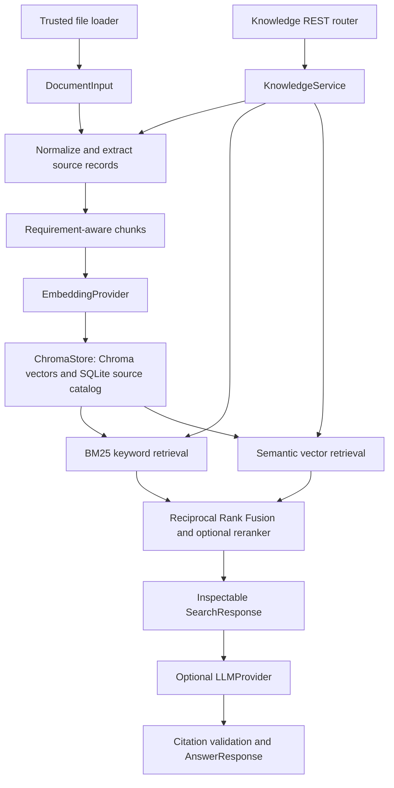

# Requirements RAG architecture

Phase 2 extends the Python monolith with an independently callable `KnowledgeService`.
No LangChain, distributed services, or model orchestrator is required.

## Ingestion and provenance

`DocumentInput` accepts bounded content, a source type, a basename, optional stable
document ID, title, version, and JSON metadata. Absolute paths are never public IDs.
Without an ID, SHA-256 of the basename determines a stable document ID. Callers should
provide IDs for distinct sources with identical filenames. Newlines normalize to LF;
offsets refer to normalized text. The content hash and UTC ingestion time are persisted.
Metadata keys that identify credentials are rejected recursively; provider settings
are never copied into metadata. This is not a content-redaction system.

Markdown extraction tracks heading ancestry and anchored requirement starts, including
plain, list, and heading forms. The default ID pattern is
`[A-Z][A-Z0-9]*(?:-[A-Z0-9]+)*-\d+`; `REQUIREMENT_ID_PATTERN` can replace it.
IDs absent from the source remain null. References within a sentence are not treated
as new requirement definitions. Non-requirement paragraphs remain searchable evidence.
This heuristic is not a complete requirements-language parser.

JSON content is a JSON-encoded string containing a nonempty array, or an object with
`requirements`. Each item needs `text`, `description`, `statement`, or `content`.
Existing `id`/`requirement_id`, `section`, and all structured item fields are preserved.
Document `title` and `version` are inherited when absent from the envelope. JSON
pointers identify the original field; no fabricated byte offsets are assigned to
escaped JSON text. Markdown versions should be supplied in the envelope.

`load_file(Path(...))` is a trusted local utility, outside the HTTP request boundary.
It supports `.md`, `.txt`, `.json`, and `.pdf`, with a 10 MB local-file limit. `pypdf`
extracts PDF text and page numbers; offsets refer to extracted text, not PDF binary
positions. Any page without extractable text rejects the document explicitly because
OCR is not supported. Tables, columns, diagrams, layout, and extraction order need
manual review. HTTP PDF envelopes are rejected; uploads and OCR are out of scope.

## Requirement-aware chunks

Each requirement forms an independent record, retaining its ID and section. Short
requirements stay whole. Long records use bounded character windows, prefer whitespace
breaks, and overlap by `CHUNK_OVERLAP`. Chunks include both the fragment and original
record text. `SourceLocation` includes normalized document offsets/lines or a JSON
pointer, PDF page when applicable, and fragment offsets within the original text.
Those fragment offsets also distinguish repeated long JSON fragments.

Chunk IDs hash a schema tag, document ID/content hash/version, requirement ID, heading,
location, and fragment. They are deterministic across unchanged ingestion and process
restarts. This favors precise revision identity: changing a document changes its chunk
IDs, including unaffected requirements in that document. Titles and metadata change
revision fingerprints while stable chunk IDs may remain the same.

## Embeddings and persistence

`EmbeddingProvider` exposes identity, dimension, `embed_documents`, and `embed_query`.
`hash` is an offline signed token-hashing baseline, using SHA-256 and normalized token
counts. Its vectors differ meaningfully by text, but it does not understand synonyms.
`openai_compatible` calls a configurable `/embeddings` server with batched input and a
model name. Returned indices, dimensions, finite values, and nonzero vectors are checked.
Set the actual server output dimension; the adapter does not request an optional,
provider-specific reduced dimension. No provider SDK is coupled to the domain.

Chroma uses a persistent local client, cosine distance, supplied embeddings, and no
automatic embedding function or model download. Collection metadata locks provider
identity (including an endpoint fingerprint), model, dimension, and schema version.
Incompatible reuse raises a configuration error even if dimensions happen to match.
Use a new `VECTOR_DB_PATH` and reingest to migrate embedding models. Model names cannot
detect an upstream model being silently changed under the same name.

`catalog.sqlite3` stores normalized sources, complete chunks, and active revision
fingerprints; `chroma/` stores vectors, text, and scalar filter metadata. New vectors
are staged with revision-prefixed vector IDs before a catalog transaction activates
them. Searches filter to active revisions and resolve returned IDs against the catalog.
Old revisions are pruned after commit. Failed staging remains invisible to retrieval;
a crash can leave inactive vectors consuming disk until document deletion or index
rebuild. Backup and restore both catalog and Chroma together while the app is stopped.

Repeated identical ingestion skips embedding. Changed content, version, title, metadata,
or chunks replaces the active revision. A process lock serializes ingestion/search
within the shared service. This is a one-service, one-process local store: use one
Uvicorn worker, not concurrent writers sharing a directory. `reindex(document_id)`
forces embedding with the current provider; index migration requires a new directory.
Deleting a document removes its Chroma vectors and catalog records. Old citation URLs
return 404 after replacement/deletion; archival citation retention is future work.

## Retrieval and ranking

Technical tokens such as `REQ-ETH-001`, `SOME/IP-SD`, `1000BASE-T1`, `0x1234`,
`IEEE 802.1Qbv`, and `VLAN 100` are retained whole, alongside searchable subterms.
BM25 computes corpus term statistics and length normalization and boosts exact IDs.
Queries containing explicit requirement IDs restrict eligible records to those IDs;
unknown IDs return no evidence rather than nearby numbered requirements.

Semantic retrieval queries Chroma using `embed_query` and applies `min_similarity`.
Keyword search does not call an embedding provider. Empty corpora, empty meaningful
queries, and unmatched filters return no hits. Filters support document ID, requirement
ID, and version. The implementation loads the bounded local catalog for BM25 per
search; caching or a larger lexical index can be added when corpus size warrants it.

For hybrid retrieval, each candidate receives `sum(1 / (rrf_constant + rank))`
across the keyword and semantic rankings. Stable chunk IDs deduplicate candidates;
chunk ID breaks score ties. `semantic_top_k`, `keyword_top_k`, `final_top_k`, RRF
constant, similarity cutoff, filters, and reranking are configurable. An optional
`Reranker` implementation sorts by query token overlap, retaining the original RRF
score and exposing its reranker signal. It is a transparent local heuristic.

Scores describe ranking or cosine similarity and are not calibrated probabilities.
Cutoffs cannot guarantee evidence relevance. No-answer retrieval evaluation therefore
measures abstention separately, and the model must also acknowledge missing evidence.

## Optional generation and citations

The LLM provider receives only the question, retrieved context, and generation settings.
It uses `/chat/completions`, JSON output, temperature, and a bounded token count.
`LLM_PROVIDER=none` is the default; missing configuration returns 503 for `ask`,
including an empty corpus. Configuration is resolved only on `ask`, so retrieval is
independent of incomplete LLM settings. Provider failures or malformed structured
responses return 502. The API never substitutes a mock answer.

With a configured provider and no evidence, generation is skipped and a deterministic
insufficient-evidence response is returned. The provider can also declare insufficient
evidence, in which case generated content is replaced with the fixed response.

The system prompt requires evidence-only claims, exact identifiers and units, inline
citations, explicit uncertainty, and separation of requirements, recommendations, and
verification outcomes. Documents may contain prompt injections. They are serialized
as untrusted evidence inside a user message, while system instructions explicitly
forbid following embedded instructions. This reduces risk but does not establish
prompt-injection immunity or authorize tools. The generation service has no tools.

Context labels `S1`, `S2`, etc. resolve only to retrieved chunks. The answer must contain
matching inline labels and valid structured labels. Referenced and mentioned requirement
IDs must belong to cited chunks, using the configured ID pattern. Invalid output returns
`invalid_citations` with generated claims suppressed. Citation metadata is assembled
from catalog-derived records, never accepted from the model. `GET /chunks/{id}` and
`GET /documents/{id}` resolve active evidence.

`cited` means reference validation passed. It does not prove every claim is entailed,
that units were interpreted correctly, or that the model obeyed all prompt instructions.
Manual engineering review remains necessary. See [evaluation](rag-evaluation.md).

## Phase 1 and Phase 3 boundary

No Phase 1 domain model, topology service, or validator is changed. RAG neither imports
NetworkX nor executes or modifies validation. Phase 1 APIs remain stateless. Its health
payload is retained for compatibility. Shared requirement IDs support explicit joins,
without converting prose into structured constraints or treating intended behavior as
verified compliance. Phase 3 can call the typed `KnowledgeService.search`, `ask`, and
existing deterministic tools independently, with human review for proposed model changes.

## Operating limits

Typed environment settings and `.env.example` cover providers, paths, batching, ranking,
chunking, and timeouts. Knowledge bodies are bounded while streaming before JSON parsing.
Only basenames are accepted; no request controls a filesystem path. Local deployment
has no authentication or tenant isolation. Bind to localhost. The Docker image sets
`VECTOR_DB_PATH=/var/lib/ee-arch`, runs unprivileged, and expects a persistent volume;
local development needs no container. Container execution and live providers require
separate environment-specific verification.

Implementation references: [Chroma Python client](https://docs.trychroma.com/reference/python)
and [Chroma collection configuration](https://cookbook.chromadb.dev/core/configuration/).
